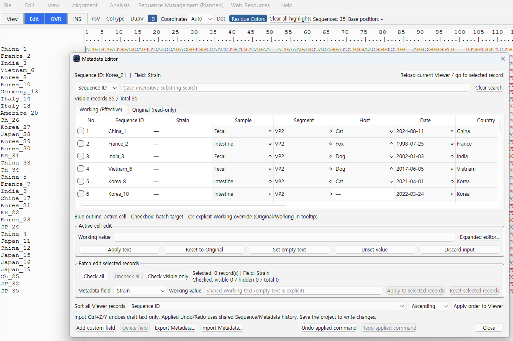

# Devlog 07 — Metadata and Sequence Annotation

> **Development update — November 24, 2026 (Beta development).** The Metadata Editor has reached a working implementation stage. Sequence annotation is currently under development. These features are not part of the publicly released Alpha 0.1.1.

## Background

Sequence comparison often requires more than an alignment. Researchers may also need to know which host a sequence came from, when and where a sample was collected, or which gene or genome segment it represents.

Encoding all of this information in sequence IDs can make records difficult to read and organize. JU SeqWorkbench is therefore developing a separate metadata layer alongside the sequence viewer, followed by a coordinate-based annotation layer.

The two layers answer different questions:

| Layer | Main purpose | Examples |
| --- | --- | --- |
| Metadata | Describe an individual sequence record | Strain, sample, host, collection date, country, segment, subtype |
| Annotation | Describe a position or region within a sequence | Gene, CDS, ORF, domain, custom region |

## Metadata Editor — current implementation

The Metadata Editor provides a table-based interface for reviewing and editing information associated with individual sequence records.

<figure>
  
  <figcaption><em>Figure 1. Metadata Editor in the current Beta development build (35 example sequence records).</em></figcaption>
</figure>

### Original and Working metadata

The metadata layer follows the same general principle as the sequence working-state design described in [Devlog 02](../02-data-layer-and-working-state/).

- **Original:** Preserves the original metadata values in a read-only view.
- **Working (Effective):** Displays the current effective values, including user edits.
- Working values can be reset to their original state. An explicitly empty value and an unset value are treated separately.
- A visual indicator identifies explicit Working overrides.

Metadata is associated with a stable internal record identity rather than relying only on the displayed sequence ID or row position. This helps maintain the connection between sequence records and their metadata when IDs or row order change.

### Editing and organizing records

The current Metadata Editor includes:

- Standard fields such as Strain, Sample, Segment, Host, Date, Country, Location, Subtype, Group, and Note, with support for custom fields.
- Search by a selected field to find relevant records.
- Individual field editing, including an expanded editor for longer text.
- Checkbox-based record selection and batch application or reset of a selected metadata field.
- Selection controls for all records or currently visible records.
- Sorting controls that allow the selected order to be applied to the sequence viewer.
- Metadata import and export controls.
- Undo/Redo for applied metadata changes through the shared sequence/metadata history.

Metadata is optional: sequences do not need to have every field populated to remain usable. Missing information should remain unassigned rather than being inferred without sufficient evidence. Metadata is retained as part of the project working state.

This makes it possible to organize a dataset using biological and sample information without repeatedly rewriting sequence IDs or maintaining all information in a separate spreadsheet.

## Sequence annotation — currently under development

Annotation is being developed as a separate, coordinate-based layer.

Where metadata describes the sequence record as a whole, annotation will describe specific regions within that sequence. The current design direction includes:

- Record-specific, manually defined features such as genes, CDSs, ORFs, domains, and custom regions.
- Preservation of feature coordinates in the record's native sequence coordinate space.
- Projection of features onto the current alignment or NT/AA display when a reliable coordinate mapping is available.
- A compact overview display for inspecting named regions alongside the sequence viewer.
- Future reuse of selected feature regions in existing sequence inspection and region-based analysis workflows.

A key challenge is maintaining the biological meaning of a feature when a sequence is edited, aligned, or displayed in a different sequence representation. Alignment gaps and actual residue insertions or deletions must be handled separately, and uncertain coordinate mappings should not be presented as exact.

These are development objectives, not a list of completed Annotation features. Automated annotation transfer and ORF prediction are not being announced as implemented in this update.

## Development direction

The aim is to connect sequence records, metadata, biological features, and existing analysis workflows without turning JU SeqWorkbench into a general-purpose annotation or phylogenetics platform.

Future work will explore the use of metadata and annotated regions for dataset selection, grouping, focused sequence comparison, and visualization. Integration with these downstream workflows is separate from the Metadata Editor implementation described above.

The publicly available Alpha remains unchanged by this development update.
